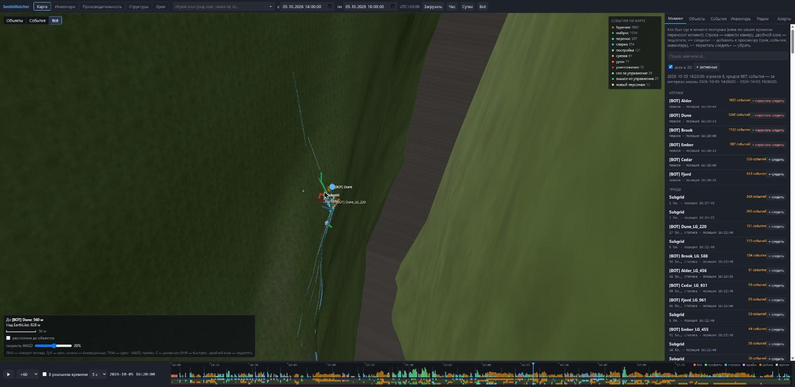
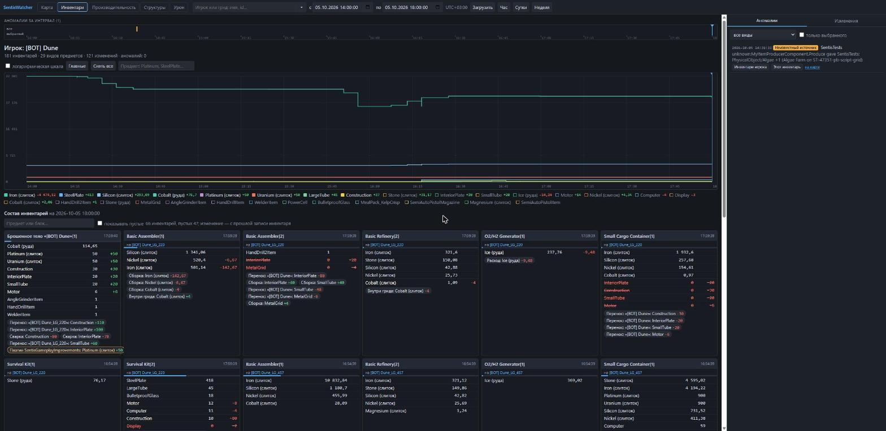
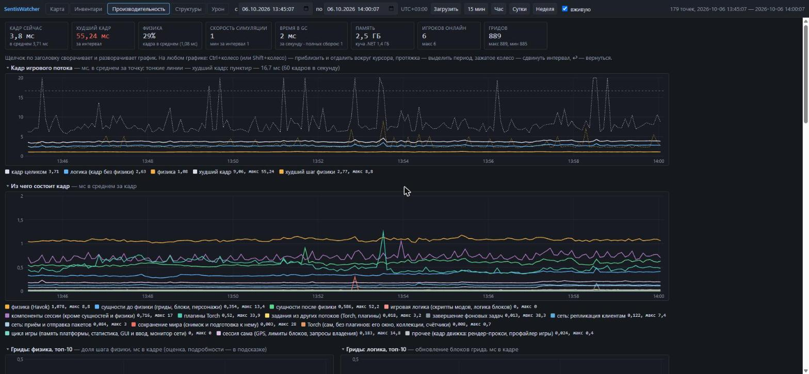
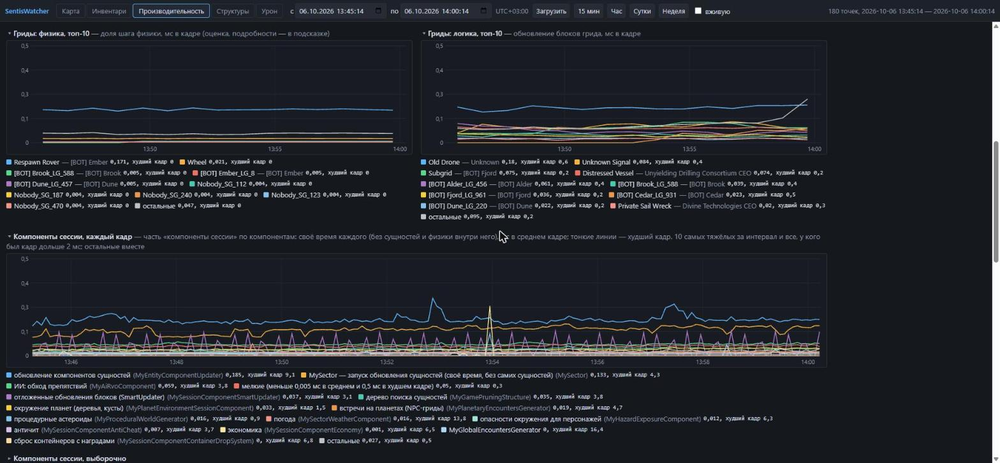
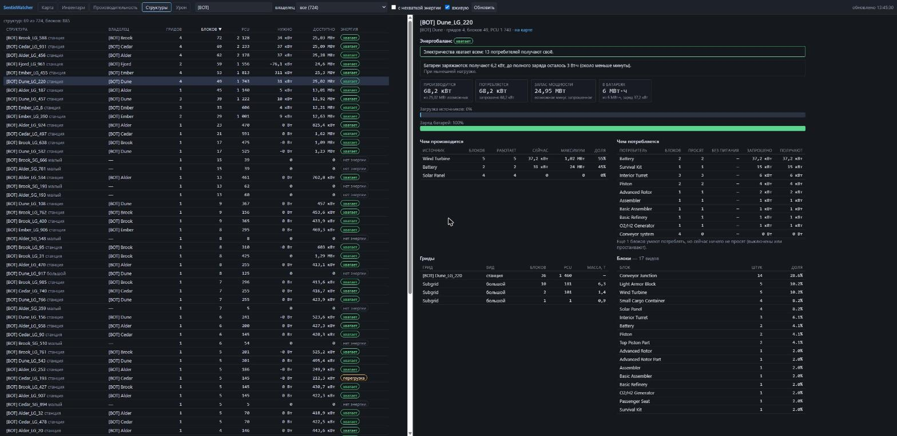
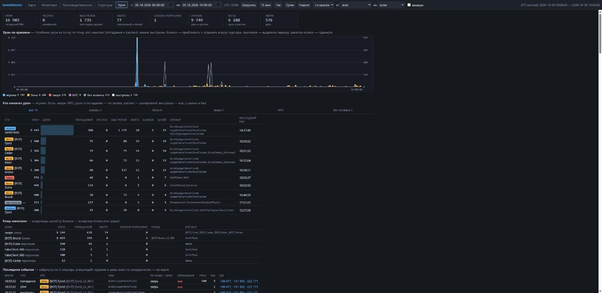

# SentisWatcher

Плагин Torch для Space Engineers: записывает, что происходит на сервере, и показывает это в браузере.

- **Кто где был.** Позиции игроков и гридов, треки на 3D-карте, проигрывание любого момента.
- **Кто что делал.** Урон, срезка, сварка, стройка, бурение, переносы предметов, смена владельцев, вставка гридов,
  прыжки, деньги, чат, вход и выход.
- **Конвейер между гридами и коннекторы.** Что конвейер, сортировщик или скрипт перенёс с одного грида на другой
  (из какого блока в какой, кто запустил: скрипт и его владелец, сортировщик или сам конвейер; суммы за 30 с), и
  когда коннектор замкнули или отжали - игрок, скрипт или сам. Переносы внутри корабля и через ротор, петлю,
  поршень не пишутся; ручной перенос игрока - отдельное событие «перенос».
- **Что где лежало.** Содержимое каждого инвентаря по времени и откуда взялось каждое изменение.
- **Поиск дюпа.** Плагин сам отмечает то, чего не бывает при честной игре.
- **Нагрузка сервера.** Из чего состоит кадр, какие гриды, скрипты, моды и плагины его грузят.

Плагин только записывает и показывает: он никого не наказывает и ничего в игре не меняет.

- [Установка](#установка)
- [Страницы](#страницы): [карта](#карта), [инвентари](#инвентари), [производительность](#производительность),
  [структуры](#структуры), [урон](#урон)
- [Аномалии](#аномалии)
- [Команды](#команды)
- [Настройки](#настройки)
- [Доступ из локальной сети](#доступ-из-локальной-сети)
- [Сколько это стоит серверу](#сколько-это-стоит-серверу)
- [Если что-то не так](#если-что-то-не-так)

## Установка

1. Скачайте архив плагина со страницы [Releases](https://github.com/despc/SentisWatcher/releases) и положите его в
   папку `Plugins` как есть. Можно и распаковать в `Plugins\SentisWatcher`: нужны `SentisWatcher.dll`,
   `System.Data.SQLite.dll` и `manifest.xml`.
2. Перезапустите Torch.
3. Откройте на машине сервера `http://127.0.0.1:18950/`.

Запись начинается сама. Данные лежат в `Instance\SentisWatcher`, по файлу на сутки, и хранятся 14 дней.

## Страницы

Вверху каждой страницы - переход между страницами, интервал времени («с» и «по», кнопки «Час», «Сутки») и галочка
«вживую». Время везде по часам сервера. Адрес в строке браузера хранит всё, что вы выбрали: ссылку можно переслать.

Шкалы времени и графики на всех страницах управляются мышью одинаково:
- протяжка выделяет период, кнопка «Показать …» открывает его;
- колесо приближает и отдаляет вокруг курсора (на странице производительности - Ctrl+колесо или Shift+колесо);
- зажатое колесо сдвигает интервал;
- «↩» возвращает прошлый интервал.

### Карта

3D-карта мира: планеты в настоящем масштабе и с настоящим рельефом, игроки и гриды на своих местах.

- **Момент.** Ползунок на шкале внизу выбирает момент; справа - все, кто был активен за интервал шкалы, самые
  активные сверху, и где они были в этот момент.
  Кнопка «▶» проигрывает запись со скоростью от ×1 до ×3600.
- **Слежение.** «+ следить» у игрока или грида добавляет его трек, события и инвентарь. Можно следить за
  несколькими сразу, у каждого свой цвет.
- **События** - цветные точки там, где они произошли: бой, стройка, бурение, переносы. Легенда справа вверху.
  Клик по событию в списке переносит время, двойной клик - подлетает к месту.
- **Шкала времени** показывает активность всего сервера (а пока кто-то добавлен к слежению — только
  отслеживаемых): бой, предметы, стройка, прыжки, добыча. При выборе
  периода камера сама переходит туда, где событий было больше всего.
- **В реальном времени** - галочка внизу: карта идёт за сервером с отставанием в пару секунд, камера следует за
  выбранным объектом.
- **Вкладки справа:** события, инвентарь на выбранный момент, кто был рядом с выбранным объектом, аномалии.

Управление камерой как в игре: левая кнопка мыши - поворот, W, A, S, D - движение, пробел и C - вверх и вниз,
Shift - быстрее, Q и E - крен, колесо - скорость движения на W, A, S, D (как у наблюдателя в игре), двойной клик по
объекту - подлететь.

### Инвентари

Что лежало у игрока, на гриде или в блоке и откуда оно взялось.

- **Поиск сверху** - игрок, грид или блок. У игрока показано всё, что ему принадлежит, и то, что на нём.
- **График** - количество каждого предмета по времени. Клик по графику показывает изменения рядом с этим моментом.
- **Откуда изменения.** По каждому предмету: сколько было, сколько стало и из чего сложилась разница -
  переработка, сборка, бурение, перенос с таким-то гридом, выдача плагином или модом. Внешние источники
  подсвечены жёлтым, необъяснённое - красным.
- **Состав инвентарей** на выбранный момент - карточка на каждый инвентарь: что лежит, что изменилось с прошлой
  записи и почему.
- **Аномалии** - полоса вверху и список справа; у каждой кнопки «Инвентари игрока», «Этот инвентарь» и ссылка на
  этот момент на карте.

### Производительность

Как работает сервер и что его грузит.

- **Карточки вверху:** текущий и худший кадр, доля физики, скорость симуляции, время в сборке мусора, память,
  игроки онлайн, число гридов.
- **Кадр игрового потока** - среднее и худший кадр; пунктир - 16,7 мс, выше него сервер не держит 60 кадров.
- **Из чего состоит кадр** - физика, гриды и блоки, моды, плагины, сеть, сохранение.
- **Гриды: физика и логика** - по 10 самых тяжёлых гридов. Физика по гридам: у движка нет времени отдельного
  грида, зато каждый кластер физики - отдельный мир Havok. Раз в несколько секунд один из кластеров шагается
  отдельно и замеряется. Шаг кадра делится между кластерами по замерам, внутри кластера - по цене,
  снятой на стенде: неспящий грид - по числу форм своей коллизии, касание вокселей - по площади опоры, тела дверей
  и коннекторов - их грида; скорость и вращение в космосе ничего не стоят. Считает это SentisOptimisations
  (`PhysicsCost`, подробности - в его README), по тому же счёту наказывает его сторож физики; без SentisOptimisations
  физика по гридам не пишется.
- **Типы блоков** - 10 самых дорогих типов блоков по всем гридам вместе (турели, поршни, сборщики...) и сколько
  блоков каждого типа обновляется за кадр: видно, дорог сам тип или их просто много.
- **Компоненты сессии** - системы игры и модов по отдельности: сразу видно, какой мод даёт длинные кадры.
- **Скрипты** - каждый программируемый блок с именем, гридом и владельцем.
- **Плагины Torch, сборка мусора, память, скорость симуляции.**
- **Игроки онлайн** - сейчас: фракция, чем управляет, где находится.
- **Кто нагружает игровой поток** - таблица за интервал: игроки, гриды, плагины, моды.

- **Долгие кадры** - самые длинные кадры за интервал и из чего каждый состоит. Вызовы, поставленные в очередь
  игрового потока (`MySandboxGame.ProcessInvoke`: плагины, Torch, фоновые потоки), замеряются по одному: вызов от
  1 мс записывается как `invoke: <тип>.<метод>`, быстрые остаются в `game.invoke_queue`. Так нашлась разморозка
  фризером грида с 89 генераторами O2/H2 (кадры по 360–440 мс), о которой раньше было видно только «invoke_queue».

**Детальный замер.** Обычно плагин замеряет один кадр из 30-90: этого хватает для средних, но редкий долгий кадр
так легко пропустить. Кнопка «Запустить детальный замер» вверху страницы включает замер каждого кадра на выбранное
время (от 1 до 10 минут); «Остановить детальный замер» прекращает его раньше. Пока он идёт, «худший кадр» на
графиках гридов, типов блоков, модов и плагинов - настоящий, а в «Долгие кадры» попадает каждый кадр длиннее
16,7 мс. Замер стоит серверу дороже обычного, поэтому включается на время и заканчивается сам. То же делает
команда `!watch load burst<секунд>`.

Щелчок по заголовку сворачивает график. В легенде клик скрывает линию, Ctrl+клик оставляет только её.

### Структуры

Мир как он есть сейчас. Структура - гриды с общей электросетью (через роторы, поршни, подвески, коннекторы).

- **Слева** список: владелец, гриды, блоки, PCU, сколько энергии нужно и сколько есть. Поиск по имени, фильтр по
  владельцу, отбор «с нехваткой энергии».
- **Справа** выбранная структура: хватает ли электричества, чем оно производится и чем потребляется, заряд
  батарей, блоки без питания, состав по видам блоков.
- **Водород:** запас в баках каждого грида и отдельно в буферах водородных двигателей; выработка и потребление
  в л/с, вход и выход баков, блоки-источники и потребители. Движители сгруппированы по общему газовому входу,
  чтобы не считать один и тот же поток несколько раз.
- **История водорода:** графики за 1/6/24 часа или 7 дней, запись в суточные SQLite-файлы независимо от открытой
  страницы. Номинальный обход — раз в 10 с, распределён по кадрам с бюджетом 0,2 мс; на большой нагрузке он может
  занимать дольше. Короткие события между замерами могут не попасть в историю. Длинные графики сохраняют минимумы
  и максимумы запаса и пики потоков, а не только равномерно выбранные точки.
- л/с — мгновенные показания, не накопленные счётчики. Перекачка в баки не считается сжиганием. При наличии
  SentisOptimisations состояние заморозки читается из его `FrozenGrids`, старые скорости замороженных блоков
  подавляются. Разовое изменение запаса при разморозке видно на графике, но не приписывается фризеру автоматически.
  История начинается после установки этой версии; для выбранной структуры показаны истории её текущих гридов,
  без восстановления прежнего состава стыковок.

### Урон

Кто с кем воюет.

- **Кто наносил урон** и **кому наносили**: попадания, срезка, выстрелы, убитые, разрушенные блоки, оружие.
- **Атакующие** делятся на игроков, ботов, зверей и NPC.
- **Фильтры вверху:** «по врагам» или весь урон; «от» - кто наносил; «по» - кому наносили. Оба фильтра вместе
  показывают, что один игрок сделал другому.
- **Последние события** со ссылкой на это место на карте.

### Сражения

Страница `battles.html` автоматически выделяет бои по полученному урону и показывает «Итоги боя»:

- Название по тегам воюющих фракций, например **ZRG vs SVP**, в списке и заголовке отчёта. Фракции берутся из боевых событий, без случайных участников сопутствующего урона; повторы при ответных атаках исключены. Если фракция неизвестна или отсутствует, показано имя участника с соответствующей пометкой.
- Начало и конец, участники, нанесённый и полученный урон, убийства/смерти, разрушенные/потерянные блоки.
- Урон от оружия грида записывается пилоту занятого управляющего/главного кокпита, иначе строителю стрелявшего блока (`BuiltBy`), не владельцу блока. При нескольких занятых кокпитах после управляющего/главного используется стабильный порядок по ID.
- MVP: больше боевого урона → при равенстве меньше получил → при равенстве больше прямых попаданий снарядами. Равные результаты не разрешаются произвольным выбором игрока.
- Процент прямых попаданий снарядами и число прыжков каждого участника (включая пассажиров). Один снаряд считается максимум один раз, независимо от числа повреждённых блоков. В старых/неполных данных — «—», не выдуманный процент.
- Победитель: сводный балл нормированных долей — 35% нанесённый боевой урон, минус 15% полученный и 50% стоимость собственных потерь. При неполной экономике — явно отмеченный расчёт только по урону (70%/30%). Фракции объединяются по историческому ID, бесфракционные и известные участники с неизвестной историей фракции остаются отдельными сторонами. Дружественный/собственный урон не улучшает результат; анонимный источник не получает чужой урон. Боты/NPC с известной атрибуцией также могут стать MVP.
- Отчёт «кто → кому → чем»: источник и повреждённый грид/персонаж, оружие/тип урона, отношение сторон.
  Нажатие на участника фильтрует отчёт по его полученному урону; доступны фильтры оружия и отношения.
- Фракции на момент записи события. В старых БД фракции неизвестны; текущие фракции вместо исторических не подставляются.
- Таймлайн урона со шкалами времени/урона и отдельной дорожкой прыжков. По наведению на столбец — боевой и сопутствующий урон; на ромб прыжка — кто прыгал, пассажиры, грид, время, дальность и прибытие/уход. Учитываются связанные прыжки за две минуты до первых попаданий и до завершения боя; прыжки не продлевают бой. Совпадающие маркеры объединяются в подсказку, а не скрывают друг друга.
- Ссылка на карту, экспорт отчёта в JSON, выбор дня БД, поиск и сортировка боёв.

Боем считается только стрельба: попадания по врагу или нейтралу (не распил) на **1000 урона и больше** за бой
(`WebData.DefaultMinCombatDamage`). Распил без стрельбы (чужой брошенный грид), случайный выстрел или турель, задевшая чужую
броню, боем не считаются: ни в списке, ни в отчёте, ни в публичном REST. Распил внутри боя со стрельбой остаётся его
частью и входит в урон, но не в эти 1000.

Сайту (публичный REST) отдаются только **бои между игроками**: в бою должно быть попадание игрока по гриду или персонажу
игрока другой стороны (другой фракции или игрока без фракции). Бои одной фракции против пиратов, ботов и других NPC
видны в веб-интерфейсе Watcher, но не публикуются. Кто владелец цели, пишется в `damage.victim_kind`; в строках до этого
столбца цель считается игроком, если её владелец сам стрелял как игрок в прочитанные дни.

Границы боя определяются **автоматически по урону**: пока он продолжается, бой продлевается; после **двух минут
без связанного урона** бой считается оконченным. Паузу задаёт настройка `Battle ends after silence (minutes)` (вкладка Web
view, группа Battles, `BattleEndMinutes`, 1–30 минут). Она действует сразу и на старые записи, ведь бои ищутся при чтении:
при более длинной паузе соседние стычки сливаются в один бой, и их ID меняются. Та же пауза задаёт окно выстрелов и
прыжков вокруг боя. Последний урон и момент завершения показаны отдельно; для свежего
боя отображается «бой продолжается». Связанный сопутствующий урон участникам и их объектам тоже продлевает бой,
даже если источник неизвестен. Погода, собственный распил, звери и выстрелы без цели не продлевают его.

Выбранный интервал только отбирает бои, а не обрезает их: полные границы ищутся автоматически, включая соседние
суточные БД. Пространственная связь (до 5 км) разделяет одновременные бои в разных частях мира. Грид, который участвовал в бою
(стрелял или был подбит), и в пределах той же паузы продолжает бой в другом месте — прыгнул или ушёл погоней дальше
5 км, — продолжает тот же бой: его новые попадания идут в этот бой, а не начинают новый. Связь по гриду, а не по
игроку: турели игрока на базе и его же корабль в другом месте — разные бои. Это эвристика: одиночное попадание тоже
эпизод, близкие перестрелки могут слиться. Защитный предел поиска
границ — 31 сутки, с предупреждением при достижении. Победа по урону — выбранное правило статистики, не доказательство
тактической победы или уничтожения корабля. Отдельно вычисляются реальные потери смонтированных компонентов и их стоимость по сохранённым минимальным игровым ценам: [экономические потери, статусы и область учёта](docs/battle-economy.md). Старые данные и неизвестные цены не подменяются нулями. [Правила MVP, точности и победы](docs/battle-statistics.md).

[Разбор продовой БД за 11 ноября 2026 и описание алгоритма](docs/battles-2026-11-11.md).

**Запись боя и сервер.** Выстрелы, пули, ракеты, попадания и потери компонентов пишутся на потоке события: на игровом,
а с SentisClusters — на потоке кластера.
- Пилот грида (`Identities.DamageIdentity`) помнится секунду для выстрелов и 30 с для их попаданий: пуля летит секунды,
  и стрелявшим остаётся тот, кто сидел при выстреле. Ищется он по занятым местам грида (`OccupiedBlocks`), а не по всем
  его блокам. Раньше станция без пилота с тысячей блоков тратила 20 мкс на каждый выстрел и на каждый повреждённый
  блок, теперь 0,2 мкс.
- Блок, задетый взрывом, берёт заслугу запуска, его стрелявший заново не ищется.
- JSON потерь компонентов делает поток записи, а не игровой кадр.
- Метки повреждённых блоков хранятся 10 минут после последнего урона (дольше самой длинной паузы боя), а не всё время
  жизни блока.
- Без лямбд и объектов на каждый вызов урона.

Подсчёт пуль:
- Пуля учитывается событием своего списка (`MyProjectiles.OnProjectileAdded`), когда ей дан слот. С кластерами вызов
  `AddInternal` на потоке кластера откладывается на игровой, и раньше каждая пуля считалась дважды (3180 пуль на 1607
  выстрелов).
- Ракета, созданная заново, получает `Init` на фоновом потоке, где `MyEntities` не видит ракетницы. Её пуск учитывается
  на игровом потоке в следующем кадре.

Взрывы:
- Учитываются и с SentisGameplayImprovements «Explosion Tweaks», который делает взрыв сам (`MissilePatch.Finish`).
  Заслуга вархеда берётся, когда он взрывается, заслуга ракеты — от её запуска.
- Блоки, которые взрыв убирает целиком без урона (`MyCubeGrid.RemoveDestroyedBlock`: внутри сферы и броня слабее урона),
  пишутся как попадание с остатком прочности, разрушение и потеря всех компонентов. Раньше вархед по блокам не
  записывался вовсе.

Проверка — сценарий SentisTests `watcher_battle_perf` (без кластеров и с ними).

## Аномалии

Плагин отмечает то, чего не бывает при честной игре. Аномалии видны на странице «Инвентари», на карте (вкладка
«Алерты») и по команде `!watch alerts`. Это повод посмотреть записи, а не приговор: плагин ничего не отбирает.

| Аномалия | Что значит |
|---|---|
| Дюп при переносе | После переноса у источника и получателя вместе стало больше предмета, чем было. |
| Изменение в обход учёта | В инвентаре стало больше, чем было плюс всё, что в него пришло. Так выглядит правка модом или плагином. |
| Пропажа | Предмета стало меньше, и никто не видел, как он ушёл. |
| Производство без сырья | Завод или сборщик выдал результат, а сырьё не списалось. |
| Лишнее при подборе или срезке | Подобрано больше, чем лежало; резак получил больше, чем стоит блок. |
| Внешний источник | Предметы выдал мод или скрипт сценария. Выдача плагинами сервера аномалией не считается. |
| Неизвестный источник | Предметы пришли путём, которого плагин не знает. |
| Недопустимое количество | Отрицательное количество или дробное у штучного предмета. |
| Переполнение | В инвентаре или баке больше, чем влезает. |
| Вставка грида игроком | Грид вставил не админ и не в творческом режиме. |

Уточнения:
- **Дробные количества от сборщика - норма.** Если эффективность сборщика в настройках мира не 1, игра списывает
  дробные части ингредиентов (при эффективности 3 кусок мяса жарится как треть куска). Такое аномалией не
  считается.
- **Дробные ручные инструменты и оружие не записываются.** На живом сервере такие стеки (например, 8.833333
  дрели) регулярно встречаются без практического следа; создание предметов по-прежнему ловится проверками
  переноса. Отрицательное количество остаётся аномалией.
- **Одна запись на одно состояние.** Тот же инвентарь с тем же количеством не отмечается заново каждый час и после
  каждого перезапуска.
- **Прототех-блоки разбираются в лом.** Прототех-компоненты блока (рама, схемы, механизмы, конденсаторы) резак
  отдаёт как `Ingot/PrototechScrap`, один к одному: так задано в определении блока (`DeconstructId`). «Сколько стоит
  блок» считается в том, во что он разбирается.
- **Починка корабля (ALE ShipFixer `!fixship`) не аномалия.** Фиксер закрывает грид и собирает его заново из
  билдеров в фоновых потоках, плагина на стеке нет: блоки возвращаются под новыми id, пилот, оставшийся в кокпите
  (например, управляя прожектором или турелью), - под своим, с тем же содержимым. Загрузка не больше того, что
  у владельца было в этих же или в только что исчезнувших инвентарях, неизвестным источником не считается.
- **Карманы NPC.** Кредиты и аптечки у экипажей NPC остаются в учёте как «необъяснено», без тревоги об обходе.
  Ненулевой Steam ID сам по себе не делает персонажа игроком: дополнительные личности ботов имеют ненулевой
  `PlayerId.SerialId`. Проверка игрока для тревог об обходе в карманах персонажа и о неизвестном источнике
  использует первичный `PlayerId` (`SerialId = 0`), включая офлайн-игроков, а не только присутствующих в сети.
  Перевод предметов NPC игроку по-прежнему записывается.
  Урожай с грядки, сразу в руки игроку, записывается как ферма.
- **Пилоты в креслах.** Инвентарь сидящего персонажа обходится через его кресло: пилот не верхняя сущность мира.

### Откуда взялся грид и гриды-дубликаты

Грид, который появился в мире не из постройки, не при разделении и не при загрузке мира, пишется событием `grid_spawned`.
В событии: откуда он пришёл, владелец, блоки, PCU и стоимость в компонентах (из чего построены его блоки, насколько они
достроены). Источники:
- `garage` — VirtualGarage;
- `services_terminal` — терминал услуг игры (хранилище гридов). Игра выдаёт такой грид вставкой и добавляет его уже из
  обратного вызова вставки, поэтому он узнаётся по своей вставке (`OnPasteFinished` от `MyGridStorageHelper`);
- `paste`, `admin` (экраны админа);
- `plugin:X`, `mod:X`.

Собственные появления игры (корабли NPC, встречи, корабли респавна) не пишутся. Это только событие: само появление
грида проблемой не считается. Источник определяется по стеку, не больше 30 гридов в секунду. Строка в логе пишется при
`Diagnostic logs`.

VirtualGarage сверяется с миром (`GarageWatch`). Если грид оказывается в мире дважды, пишутся событие и алерт
`grid_dupe` и предупреждение (`SentisWatcher.Garage`):
- грид сдали в гараж (`VirtualGarageSave.Store` вернул файл), а через 3 с он всё ещё в мире и файл на месте;
- грид выдали из гаража (`VirtualGarageLoad.Load`), а в мире ещё стоит то, из чего сделан файл. В файле гаража сохранены
  прежние EntityId гридов и блоков, а копия получает новые;
- ту же запись гаража выдали ещё раз, а копия с прошлой выдачи всё ещё в мире. После краха гараж возвращает файл, но
  тогда и копия уходит вместе с откатом мира. Выдачи хранятся 30 дней в `garage-takeouts.json` рядом с суточными базами.

Каждая сдача и выдача пишется событиями `garage_in` и `garage_out`. Проверка — `reg_garage_dupe`.

### Грид под огнём без урона

Если по гриду стреляют, а урона он не получает и при этом стоит вне безопасных зон и вне PVE-зоны
SentisGameplayImprovements (`PvECore.IsProtected`: там игроки гридам урона не наносят по правилу зоны), это пишется событием
`damage_blocked`, предупреждением в логе (`SentisWatcher.DamageBlocked`) и алертом. Считаются прямые попадания пуль и
ракет по гриду врага или нейтрала (те же `round_hit`, что у меткости). Окно — 10 с на грид. Срабатывает при 5
попаданиях и больше, если за это время грид не получил урона ни от чего, включая взрывы и таран, и там, где он стоит,
урон разрешён. Причина берётся из состояния грида:
- блоки неразрушаемы во всём мире (`DestructibleBlocks` сессии);
- у грида выключено `DestructibleBlocks` или стоит `Immune` (админ, плагин, сценарий): пули, ракеты, взрывы и таран
  игры тогда останавливаются ещё до блока;
- множитель урона грида (`GridGeneralDamageModifier`, свой или корня механизма) равен 0;
- множитель урона блоков (`BlockGeneralDamageModifier`) равен 0;
- урон обнулил обработчик урона (мод, плагин). Обработчик Watcher идёт последним, поэтому видит, что оставили
  другие. Перечисляются все обработчики урона, кроме Watcher;
- ничего из этого, а попадания до урона блока не дошли: значит, между ними стоит патч плагина или мод.

Строка: грид, владелец, место, число попаданий, причина, кто стрелял и чем. Один грид — не чаще раза в 10 минут
(алерт — раз в час, как все алерты). Проверка — `reg_damage_blocked`.

### Админские сейф-зоны

Сейф-зоны без блока (у станций экономики, из меню админа, от плагинов) пишутся, когда пропадают, с причиной: событие
`safezone_removed` (имя, id, радиус, вкл./выкл., место, причина). Причина берётся из стека того, кто закрыл зону: игра
подписана на своё событие `OnRemoveSafeZone`, патчей нет.
- **Станция осталась без игроков** (`MyStationCellGenerator.CloseObjectSeed`): норма, зона уходит вместе со
  станцией и появится снова с ней. Только событие, строка в логе — при `Diagnostic logs`.
- **Удалена из меню админа** — с именем и Steam ID админа; **закрыта плагином, модом или Torch** — первые кадры стека
  не из игры. Всегда: предупреждение в логе (`SentisWatcher.SafeZones`) с началом стека и алерт `safezone_removed`.
- **Выгрузка мира** не пишется.

Изменение настроек такой зоны (событие игры `OnSafeZoneUpdated`) пишется событием `safezone_changed`, предупреждением и
алертом: что поменялось (вкл./выкл., форма, радиус, размер, что разрешено, доступ игроков, фракций, гридов, место) и через
что — меню админа (с админом), настройки блока сейф-зоны игрока (до зоны без блока это доходить не должно: SentisAnticheat
отказывает) или кадры плагина, мода. Плагин, меняющий поля зоны напрямую, события не вызывает и не виден.

При каждой загрузке мира станции экономики, которые стоят без своей сейф-зоны, отмечаются предупреждением и алертом
`station_no_safezone`: игра сама такую зону не восстанавливает. Восстанавливает SentisGameplayImprovements
(`StationSafeZones`). Проверка — сценарий SentisTests `safezone_watch`.

## Команды

Для админов, в чате. Ответ приходит в чат и целиком сохраняется в `watch-<время>.txt` рядом с данными (в чате
длинный ответ обрезается). В квадратных скобках - необязательное: за сколько минут смотреть и сколько минут назад
это закончилось.

| Команда | Что покажет |
|---|---|
| `!watch status` | Куда пишется, сколько записано, не теряется ли что-нибудь. |
| `!watch player <ник или id> [минут] [назад]` | Где был игрок, что делал он и что делали с ним. |
| `!watch grid <имя или id> [минут] [назад]` | Движение грида, владельцы, кто сколько урона нанёс, срезал, сварил. |
| `!watch near <x> <y> <z> <радиус> [минут] [назад]` | Кто был в этом месте. |
| `!watch inventory <id> [минут] [назад]` | Что лежало в инвентарях блока, персонажа или грида и как менялось. |
| `!watch alerts [минут]` | Найденные аномалии. |
| `!watch load [минут]` | Кто нагружает сервер: игроки, гриды, плагины, моды. |
| `!watch load on` / `off` | Включить или выключить замер нагрузки без перезапуска. |
| `!watch load burst<секунд>[@<мс>]` | Замерять каждый кадр это время: чтобы поймать, из чего сделан редкий долгий кадр. |

## Настройки

Страница плагина в Torch или файл `Instance\SentisWatcher.cfg`.

| Параметр | По умолчанию | Что |
|---|---|---|
| `Enabled` | да | Записывать. |
| `RetentionDays` | 14 | Сколько дней хранить записи. |
| `DatabaseFolder` | пусто | Куда писать; пусто - `Instance\SentisWatcher`. |
| `WebEnabled` | да | Страницы в браузере. |
| `WebPort` | 18950 | Порт страниц. |
| `WebLan` | нет | Открывать страницы из локальной сети, см. ниже. |
| `LoadSampling` | да | Замер нагрузки по гридам, скриптам, модам и плагинам. |
| `DiagnosticLogs` | нет | Подробности работы плагина в логе Torch. Ошибки пишутся всегда. |

## Доступ из локальной сети

По умолчанию страницы открываются только на машине сервера. Чтобы открывать их с других компьютеров сети:

1. Включите `WebLan` («Web view on the network»).
2. Один раз от администратора разрешите Windows слушать порт:
   `netsh http add urlacl url=http://+:18950/ user=<учётная запись, под которой запущен Torch>`
3. Откройте порт в брандмауэре Windows.

Без второго шага плагин остаётся на `127.0.0.1` и пишет в лог команду, которую нужно выполнить.

**У страниц нет пароля**, а на них видны позиции игроков и содержимое инвентарей; кроме того, любой, кто открыл
страницу производительности, может запустить детальный замер. Открывайте их только в сети,
которой доверяете, и не выставляйте порт в интернет.

## Статистика для сайта сервера

Отдельный порт для публичного сайта (`PublicPort`, «Public stats port»; 0 — выключено). По умолчанию отдаёт только
`/online` и `/perf`: ни позиций, ни гридов, ни инвентарей, ни ID. Дополнительно можно включить защищённый REST сражений
(ниже), но не доступ к приватному `/api/*`. Слушает все адреса машины, если адрес разрешён
(`netsh http add urlacl url=http://+:<порт>/ user=<учётная запись Torch>` и порт в брандмауэре), иначе `127.0.0.1` и
команда в логе. Браузерам с чужого сайта отвечает с `Access-Control-Allow-Origin` из `PublicOrigin` («Public stats site»,
по умолчанию `*`; лучше вписать адрес своего сайта). Ответы кэшируются: онлайн на 10 с, графики на минуту.

- `GET /online` — кто сейчас на сервере:
  `{"at": <мс UTC>, "players": 3, "bots": 5, "online": [{"name": "...", "faction": "TAG", "bot": false}, ...]}`.
  Боты SentisAi отмечены `bot: true` (у них всегда префикс `[BOT]`).
- `GET /perf?hours=3` (1–24 часа, по умолчанию 3) — точка в минуту:
  `{"from", "to", "minutes": 1, "points": [{"t", "sim", "load", "frame", "frameMax", "players"}]}`.
  `sim` — скорость симуляции (1 — полная); `load` — загрузка игрового потока, ядра, на котором идёт симуляция: доля тика,
  которую занимает средний кадр, % (16,7 мс = 100%; выше 100 симуляция замедляется); `frame` и `frameMax` — средний и
  худший кадр минуты, мс; `players` — игроки онлайн вместе с ботами. Минуты, когда сервер не работал, пропущены.

### REST сражений для сайта

На том же `PublicPort` доступны отдельные методы, **по умолчанию выключенные**:

- `GET /battles?hours=24&page=1&pageSize=20` — список опубликованных боёв (до 7 суток, до 50 на страницу).
- `GET /battles/{id}` — итоги, участники/фракции, кто кому чем наносил урон, таймлайн и прыжки с именами.

Нужен `Authorization: Bearer ...` **с бэкенда сайта**, а не из браузерного JavaScript. Ключ хранится в приватном файле,
в конфиге указан только путь (`PublicBattlesKeyFile`). REST включён по умолчанию (`PublicBattlesEnabled`, при ненулевом
`PublicPort`). Если путь к ключу не задан, Watcher при первом старте сам создаёт `Instance\SentisWatcher-Secrets\battles.key`:
256 случайных бит, файл и папка без наследуемых прав, доступ только у учётки Torch, SYSTEM и администраторов. Существующий
файл не трогается. Сайт на той же машине разворачивается скриптом `SentisSite	ools\deploy-prod.ps1`, который берёт ключ
оттуда.
Ключ можно безопасно создать скриптом `tools/create-battle-api-key.ps1`, который не печатает его и задаёт приватный ACL.

Выдаются только завершённые бои с задержкой 15 минут после окончания боя (настройка `PublicBattlesDelayMinutes`, минимум 5).

**Участникам в чат и `!br`.** Когда сражение опубликовано, то есть кончилось и прошла задержка, каждому его участнику,
который сейчас онлайн, один раз приходит сообщение в чат: «Сражение окончено, Победитель - {игрок или фракция}, MVP -
{игрок}. Полные результаты - команда "!br" в чат».
- Участник — игрок, который в этом сражении стрелял или получал урон. Остальные игроки сообщения не получают.
- Победитель и MVP берутся из итога сражения, как на сайте. Варианты: «ничья», «не определён»; при равенстве перечисляются
  несколько MVP, а если MVP нет, эта часть не пишется. Неизвестный участник пишется «Неизвестный участник», а не номером.
- Сообщается только о сражениях, которые есть на сайте (между игроками). Сражения, опубликованные до старта сервера, не
  объявляются: после рестарта чат не заваливается старыми.
- Команда `!br` открывает в оверлее Steam страницу последнего опубликованного сражения игрока за неделю. Пример:
  `https://sentis-project.online/battles.html?hours=24&battle=<id>`, где `hours` — окно списка на сайте (24, 72 или 168 ч),
  в котором это сражение есть. Страница не из белого списка игры открывается через фильтр ссылок Steam, как MOTD у
  Essentials.
- Адрес страницы задаётся настройкой `BattleReportPage`. Пустая настройка выключает уведомления. Нужна включённая
  публикация сражений.
Координаты, Steam/SE identity/entity IDs и инвентари не выдаются. Участники и объекты имеют
локальные ссылки `p1`/`e1`. Сохранённые названия кораблей публикуются очищенным текстом; если имени нет, остаётся подпись «Грид 1». Сайт должен экранировать пользовательские имена.

Эти маршруты принимают только loopback-подключения: для внешнего бэкенда нужен локальный **HTTPS reverse proxy**.
CORS на них отключён; `/online` и `/perf` работают как раньше. Есть кэш, пагинация, лимит 60 авторизованных запросов в минуту
и не более одной тяжёлой операции одновременно. Неизвестные параметры и произвольные временные диапазоны запрещены.

Автонастройка на Windows: **[`tools/setup-battle-api.ps1`](tools/setup-battle-api.ps1)** — приватный ключ/ACL,
бэкап и правка конфига, опциональные секреты локального бэкенда и HTTPS через Caddy.
**[Примеры запуска на проде](docs/setup-battle-api.md)**. Скрипт не меняет работающий Torch без явного выбора службы
и подтверждения сохранённого мира; для ручного запуска сначала сохранить мир и остановить сервер.

**[Настройка, безопасность, JSON-контракты и пример reverse proxy](docs/public-battles-api.md).**
Не открывайте в интернет приватный порт 18950 и не кладите API-ключ в URL, чат, логи или репозиторий.

## Сколько это стоит серверу

На стенде со 128 кораблями, 352 тысячами блоков и 64 игроками плагин занимает в среднем 0,05 мс кадра, в худшем
кадре - 0,8 мс. Запись на диск идёт в отдельном потоке и игру не задерживает. Покадровый замер компонентов сессии
стоит ещё 0,03-0,05 мс на кадр; замер нагрузки можно выключить (`LoadSampling` или `!watch load off`).

Если диск не успевает, плагин сначала отбрасывает позиции и только в крайнем случае события; сколько отброшено,
показывает `!watch status`.

## Лицензия

[Apache License 2.0](LICENSE). Код можно использовать, менять и распространять, в том числе в составе своих
плагинов; при этом нужно сохранить текст лицензии и файл [NOTICE](NOTICE) с указанием автора и источника и
отметить, какие файлы изменены. Оба файла лежат и в сборке рядом с dll плагина.
